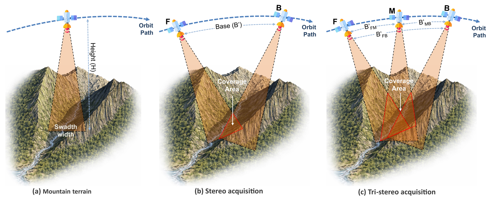
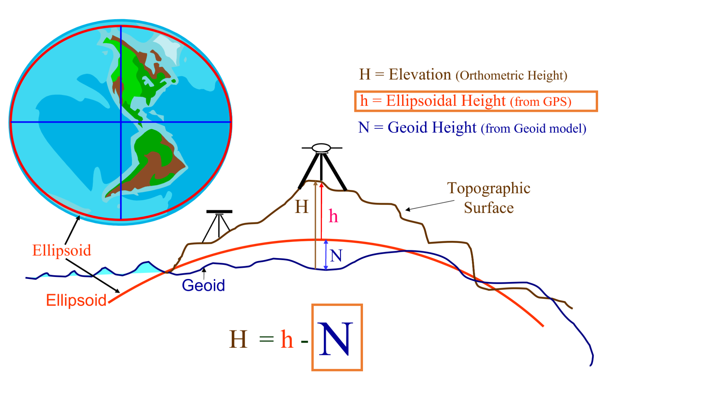

# WASA-DEM

<a href="assets/WASA-DEM-official-logo.jpg"></a>

**Workflow for Ames-based Satellite Analysis and Digital Elevation Model Generation**

**Current software version: v1.5.4** · Formerly named *Pléiades ASP Workflow*

**WASA-DEM** is a reproducible, open-source **Python- and Jupyter-based workflow** for optical satellite stereo and tri-stereo photogrammetry, 3D point-cloud reconstruction, and high-resolution **digital surface model (DSM)** generation using the **NASA Ames Stereo Pipeline (ASP)**. The current implementation supports **Pléiades, Pléiades NEO, and SPOT 6/7**.

> **Backward compatibility:** The WASA-DEM identity and optional Windows desktop launcher do not change the Python distribution (`pleiades-asp-workflow`), GitHub URL, existing CLI commands, default workspace/notebook paths, ASP processing methods, or v1.5.4 version identifier. The previously archived research software (DOI below) remains cited under its original publication title.

- The guided Jupyter interface supports the complete DSM-generation workflow, including image preparation, metadata and stereo-geometry inspection, reference-DEM preparation, ASP pre-processing and map projection, point-cloud reconstruction, final DSM generation, and optional LiDAR-based co-registration.

- The software is implemented primarily in **Python**, with **Jupyter notebooks and interactive controls** used to manage processing parameters, execution, quality control, and outputs across the three supported satellite sensors.

For reproducibility of the associated study, the reference processing version is **Ames Stereo Pipeline 3.3.0**.

**Quick links:** [Install or update](#installation-and-updates) · [WASA-DEM capabilities](#what-this-package-provides) · [Research software DOI](https://doi.org/10.57745/4OQDHQ) · [Related geodesy software: ElevDatum](https://github.com/IslamKOA/geodetic-elevation-data-toolkit)

**Discover WASA-DEM:** Developed by **Islam KOA (IslamKOA)**, this reproducible satellite photogrammetry software supports optical stereo and tri-stereo 3D terrain reconstruction, Pléiades/Pléiades NEO/SPOT 6/7 imagery, NASA Ames Stereo Pipeline (ASP), point clouds, digital surface models (DSMs), mountain topography, and geomorphology applications. [Developer profile](https://github.com/IslamKOA) · [Citable archive](https://doi.org/10.57745/4OQDHQ).

**Community and reproducibility:** [Report an issue](https://github.com/IslamKOA/pleiades-asp-workflow/issues) · [Contributing guidelines](CONTRIBUTING.md) · [How to cite this software](CITATION.cff)

## What this package provides

- Guided preparation of Pléiades / Pléiades NEO / SPOT imagery and metadata.
- Support for stereo and tri-stereo acquisitions.
- Strict DIMAP tile handling, including `R1C1` anchor validation for tiled products.
- Metadata and stereo-geometry inspection.
- DIM-versus-RPC camera-model consistency diagnostics.
- Reference-DEM preparation using IGN LiDAR HD, Copernicus GLO-30, SRTM1, or an existing DEM.
- Vertical-reference handling for ellipsoidal / geoid-based DEM conversion.
- Restartable ASP pre-processing:
  - `bundle_adjust`
  - preliminary `parallel_stereo`
  - preliminary `point2dem`
  - `pc_align`
  - camera-transform propagation
  - `mapproject`
- Point-cloud reconstruction and final DSM generation.
- Optional co-registration in a separate xDEM notebook.
- Runtime summaries and Run / Pause / Resume / Stop controls for long processes.
- Original scientific notebooks retained under `original_notebooks/` for traceability.

## Installation and updates

**Choose your operating system and task:** [Windows — new installation](#windows--new-installation) · [Windows — update](#windows--update-an-existing-installation) · [Linux — Install](#linux--install) · [Linux — Update](#linux--update)

The recommended installers support Python **3.10+** (Python 3.11 for a new environment), prefer an existing usable **Conda/Mamba/Micromamba** installation, and can download standalone Micromamba if none is available. **Git and a separately installed system Python are not required.** Internet connectivity is needed for initial downloads.

### Before any update

- **Close JupyterLab and stop running notebooks/processes.** Do not update while stereo processing is running.
- **Back up any notebooks you edited yourself** outside the installed workspace, particularly `Pleiades_ASP_Workflow.ipynb` and the `coregistration/` and `point_density/` notebooks. The `pleiades-workflow-init` command refreshes **package-managed notebooks**, so edits to these may be overwritten.
- The installers are designed to **reuse the `pleiades_asp` environment** and preserve user project data (including `data/` and unrelated files). **Do not delete Conda/Micromamba, ASP, WSL, or project folders** before trying an update.
- Installing from the GitHub **`main`** branch provides the latest changes, even when the Python package version still displays **v1.5.4**. The published Research Data Gouv DOI refers to the originally archived release.

### Windows — new installation

Requirements: Windows 10/11 (64-bit), PowerShell, internet access, and permission to enable **WSL/Ubuntu** if not installed. First-time WSL setup may require administrator approval, a restart, and creation of a Linux user.

Open **Windows PowerShell** and run:

```powershell
Invoke-WebRequest `
  -Uri "https://raw.githubusercontent.com/IslamKOA/pleiades-asp-workflow/main/install_windows.ps1" `
  -OutFile "$HOME\Downloads\install_windows.ps1"

powershell.exe -NoProfile -ExecutionPolicy Bypass `
  -File "$HOME\Downloads\install_windows.ps1"
```

The installer checks available environment managers, reuses an existing `pleiades_asp` environment or creates it with Python 3.11, installs WASA-DEM and required Python dependencies, sets up/verifies WSL and ASP, prepares JupyterLab, and creates the **WASA-DEM** desktop shortcut with the official square logo from GitHub (without the lower terrain). The interface runs under Windows, while ASP processing uses WSL.

The optional [first-time helper](install_windows_first_time.ps1) now calls **the same standard installer**; you do **not** need to run both scripts.

### Windows — update an existing installation

**Recommended for repairing installations or installing missing dependencies:** download and rerun the latest standard installer. It reuses a working `pleiades_asp` environment and refreshes the desktop shortcut and icon.

```powershell
Invoke-WebRequest `
  -Uri "https://raw.githubusercontent.com/IslamKOA/pleiades-asp-workflow/main/install_windows.ps1" `
  -OutFile "$HOME\Downloads\install_windows.ps1"

powershell.exe -NoProfile -ExecutionPolicy Bypass `
  -File "$HOME\Downloads\install_windows.ps1"
```

**Important:** The current full Windows installer uses `pip install --upgrade --force-reinstall`, which can reinstall/update Python dependencies. It also checks ASP and overwrites **package-managed** notebook resources. Back up notebook edits first; the full installer is useful for repairs but is not a minimal code-only update.

**Advanced: refresh WASA-DEM code without reinstalling dependencies or ASP** (only when your environment is already working). For an existing **Conda** installation:

```powershell
conda run -n pleiades_asp python -m pip install --upgrade --force-reinstall --no-deps "https://github.com/IslamKOA/pleiades-asp-workflow/archive/refs/heads/main.zip"
conda run -n pleiades_asp pleiades-workflow-init
```

For an existing **Micromamba** or **Mamba** environment, replace `conda run` with `micromamba run` or `mamba run`, respectively. The manager must be accessible in PowerShell; otherwise use the standard installer, which searches known installation paths. The lightweight commands **do not** install ASP, WSL, or missing dependencies. Initializing the workspace still replaces package-managed notebooks.

**Shortcut/icon only:** if the environment is already working, run [the shortcut creator](create_wasa_dem_shortcut.ps1) alone. It automatically downloads the current WASA-DEM icon from GitHub when the image is not beside the script:

```powershell
Invoke-WebRequest `
  -Uri "https://raw.githubusercontent.com/IslamKOA/pleiades-asp-workflow/main/create_wasa_dem_shortcut.ps1" `
  -OutFile "$HOME\Downloads\create_wasa_dem_shortcut.ps1"

powershell.exe -NoProfile -ExecutionPolicy Bypass `
  -File "$HOME\Downloads\create_wasa_dem_shortcut.ps1"
```

If you encountered `SyntaxError: '(' was never closed` during the old `Verify environment Python` step, download the **latest** installer again: the Windows Conda quoting bug has been corrected. Do not remove the existing Python environment.

**ASP version:** ASP **3.3.0** is the scientific reference and default. To request a different main ASP version in the full installer, set `$env:PLEIADES_ASP_VERSION = "3.4.0"` before launching it. The optional `point2las` export uses an isolated ASP 3.5.0 companion when the selected main version is older than 3.5.0.

### Linux — Install

**Install WASA-DEM with NASA ASP 3.3.0 (default):**

```bash
curl -fsSL https://raw.githubusercontent.com/IslamKOA/pleiades-asp-workflow/main/install_linux.sh -o install_linux.sh && PLEIADES_ASP_VERSION=3.3.0 bash install_linux.sh
```

**Change the ASP version:** replace `3.3.0` with `3.4.0` or `3.5.0` in the command above. For example, to install ASP 3.5.0:

```bash
curl -fsSL https://raw.githubusercontent.com/IslamKOA/pleiades-asp-workflow/main/install_linux.sh -o install_linux.sh && PLEIADES_ASP_VERSION=3.5.0 bash install_linux.sh
```

**If `curl` is unavailable**, use `wget`:

```bash
wget -qO install_linux.sh https://raw.githubusercontent.com/IslamKOA/pleiades-asp-workflow/main/install_linux.sh && PLEIADES_ASP_VERSION=3.3.0 bash install_linux.sh
```

The installer checks Conda first, then Micromamba/Mamba; if no usable manager is available, it installs Micromamba automatically. It creates or reuses `pleiades_asp`, downloads WASA-DEM from GitHub without requiring Git, and installs/verifies the selected ASP version. The optional `point2las` export uses a separate ASP 3.5.0 companion on first use when the main ASP is 3.3.0 or 3.4.0. The installer preserves research data and customized notebooks and creates a simple `~/.local/bin/wasa-dem` launch command.

### Linux — Update

**Update WASA-DEM:**

```bash
curl -fsSL https://raw.githubusercontent.com/IslamKOA/pleiades-asp-workflow/main/update_linux.sh -o update_linux.sh && bash update_linux.sh
```

**If `curl` is unavailable**, use `wget`:

```bash
wget -qO update_linux.sh https://raw.githubusercontent.com/IslamKOA/pleiades-asp-workflow/main/update_linux.sh && bash update_linux.sh
```

The updater reuses the existing `pleiades_asp` environment and keeps ASP, scientific dependencies, research data, and customized notebooks unchanged. The update does not require Conda activation beforehand.

### Launch WASA-DEM

**Windows:** double-click the **WASA-DEM** desktop shortcut. The installer automatically supplies the GitHub-hosted application icon. To start manually from PowerShell using Conda:

```powershell
conda run -n pleiades_asp jupyter lab "$HOME\Pleiades_ASP_Workflow\Pleiades_ASP_Workflow.ipynb"
```

For Micromamba/Mamba, substitute the corresponding manager command.

**Linux:** after installation or update, start WASA-DEM with one command—no Conda activation or notebook path required:

```bash
~/.local/bin/wasa-dem
```

The installer and updater automatically create or refresh this terminal launcher using the correct `pleiades_asp` environment. It starts JupyterLab normally; if there is no local web browser, copy the Jupyter URL to a browser that can reach your server.

In JupyterLab, open `Pleiades_ASP_Workflow.ipynb` and click **▶ Start WASA-DEM**. The default `Pleiades_ASP_Workflow/` folder and Python package name remain unchanged for compatibility.

### Verify the installation

Run these **inside the `pleiades_asp` environment** (for example after `conda activate pleiades_asp` or `micromamba activate pleiades_asp`):

```bash
python --version
pleiades-workflow-info
asp-version
asp-doctor
```

A functional launch of the Jupyter interface and a successful ASP environment check are stronger evidence than the presence of a desktop shortcut alone. If a verification command fails, keep the error log and troubleshoot it before running processing jobs.

---

### ASP documentation

The scientific processing engine used by this workflow is the NASA Ames Stereo Pipeline. For ASP command definitions, camera models, stereo sessions, and detailed processing behavior, consult the official documentation:

- ASP documentation: https://stereopipeline.readthedocs.io/en/latest/
- ASP source repository: https://github.com/NeoGeographyToolkit/StereoPipeline
- Pléiades processing example: https://stereopipeline.readthedocs.io/en/latest/examples/pleiades.html

This workflow provides a tested orchestration and quality-control layer around ASP; it does not replace the ASP documentation.

## Workflow

```text
1. Prepare data
   ↓
2. Metadata and geometry
   ↓
3. Pre-processing
   ├─ Reference DEM preparation and QC
   ├─ Bundle adjustment
   ├─ Preliminary stereo
   ├─ Preliminary DSM
   ├─ Reference alignment (pc_align)
   ├─ Camera transform
   └─ Map projection
   ↓
4. Point-cloud reconstruction
   ↓
5. Final DSM generation
   ↓
6. Optional co-registration (outside ASP; xDEM notebook)
```

The interface preserves the tested scientific processing sequence while keeping the intended parameters user-configurable.

## Prepare data and tiled DIMAP products



For tri-stereo projects, the three input folders are temporary labels during initial preparation. The **Metadata and geometry** step reads acquisition times from DIMAP metadata and normalizes the prepared views to:

```text
earliest acquisition  -> A = Forward (F)
middle acquisition    -> B = Middle / near-nadir (M)
latest acquisition    -> C = Backward (B)
```

Prepared TIFF, RPC XML, DIM XML, VRT, and optional AOI-cropped products are relabeled consistently. The resulting view assignment is saved under `metadata/*_view_assignment.csv`.

For tiled DIMAP products, `R1C1` is treated as the anchor tile. If the required image extends into additional tiles, enable **Merge selected image tiles** and include `R1C1` together with all required additional tile IDs. The interface blocks invalid tile selections rather than silently preparing a later tile alone.

## Resume an existing project

`Prepare data` writes the project configuration to `project_settings.json`.

Use **Load / resume existing project** to restore:

- original acquisition-folder paths;
- project name and output location;
- acquisition mode and platform;
- tile selections;
- AOI/crop settings;
- prepared image previews;
- metadata products;
- reference DEM paths and QC displays;
- completed ASP pre-processing products;
- bundle-adjustment tables;
- preliminary DSM information and preview;
- `pc_align` diagnostics and transformation matrix;
- camera-transform results;
- map-projected image tables and previews;
- point-cloud reconstruction products;
- final DSM tables and previews.

Loading an existing project **does not rerun ASP**. Later pre-processing stages may reuse compatible prerequisite products already present on disk, so users do not need to rerun the immediately preceding stage merely because the notebook was closed and reopened.

**Start new project / clear form** resets only the notebook/interface state. It does not delete project outputs or source imagery from disk.

## Reference DEM preparation

The workflow distinguishes two reference roles:

1. **Alignment reference DEM** — used by `pc_align`.
2. **Map-projection DEM** — used by `mapproject`.

For mainland France, the default starting configuration used in the study is:

```text
Alignment reference:      IGN LiDAR HD
Alignment resolution:     1 m
Map-projection reference: IGN LiDAR HD
Map DEM resolution:       50 m
Vertical model:           RAF20
```

Copernicus GLO-30 and SRTM1 are also supported as global alternatives. When one global DEM is selected for the alignment workflow, the interface can reuse the same prepared ellipsoidal DEM for map projection.

Reference DEM QC reports CRS, resolution, extent, elevation range, valid coverage, and the vertical-correction raster when applicable.

Vertical conversion follows:

```text
N = h - H
h = H + N
H = h - N
```

where `h` is ellipsoidal height, `H` is orthometric height, and `N` is geoid/quasi-geoid separation.



## ASP pre-processing

The tested sequence is:

```text
Reference DEM QC
→ bundle_adjust
→ preliminary parallel_stereo
→ preliminary point2dem
→ pc_align
→ apply alignment transform to adjusted cameras
→ mapproject
```

The reproducibility defaults used by the study include:

```text
Camera model / ASP session          RPC / -t rpc
Bundle-adjust robust threshold      2
Bundle-adjust max iterations        500
Bundle-adjust cost function         Cauchy
Preliminary algorithm               BM — asp_bm
Preliminary CK:SK                   35:45
Preliminary cost mode               2
Preliminary xcorr threshold         2
Correlation memory                  10240 MB
Correlation tile size               3200
Subpixel mode                       2
Preliminary DSM resolution          1.0 m
Preliminary DSM nodata              -9999
pc_align max displacement           250 m
pc_align iterations                 100
Mapproject threads                  18
Map-projected image resolution      0.5 m
```

These values are starting settings from the associated study, not universal optima. Sensor characteristics, acquisition geometry, terrain, illumination, shadow, and computational resources may justify different values.

### Camera models

The public workflow supports:

```text
RPC — reproducibility default
  ASP session: -t rpc
  Camera files: RPC_A.XML / RPC_B.XML / RPC_C.XML

Pléiades exact linescan — optional
  ASP session: -t pleiades
  Camera files: DIM_A.XML / DIM_B.XML / DIM_C.XML
```

The selected camera representation is propagated consistently through the camera-dependent ASP stages. Exact DIM processing should use full prepared images because the optional AOI crop updates RPC offsets but does not reparameterize the exact DIM linescan model for the cropped raster.

## Point-cloud reconstruction and final DSM

The interface supports stereo-pair processing and tri-stereo configurations built from the available image pairs. Full tri-stereo merged reconstruction uses pairwise point clouds followed by `pc_merge`.

Tested final DSM starting values include:

```text
Final DSM resolution                  1 m
Maximum valid triangulation error     1 m
```

The interface reports output products, reconstruction diagnostics, previews, and per-stage runtime information.

## Optional co-registration

Co-registration is intentionally kept outside ASP as the final optional workflow stage.

After Final DSM generation, the interface provides **Open optional co-registration notebook**. It writes `coregistration_handoff.json` in the active project folder and opens:

```text
coregistration/Coregistration_Process-Final-withPlannimetric.ipynb
```

The notebook contains the latest xDEM / Nuth & Kääb workflow used during development. Review its **INPUTS** cell before execution, especially the final DSM, external reference DEM, and stable-area inputs.

## Optional LAZ export and point-cloud density

The separate [LAZ export and point-cloud density notebook](src/pleiades_asp_workflow/interface_bundle/point_density/README.md) converts ASP `*-PC.tif` point clouds to LAZ, optionally retains the triangulation error in LAS 1.4, and reports rectangular bounding-box point density.

**ASP version isolation (LAZ export only):** If you use **ASP 3.3.0 or 3.4.0** for stereo/DSM processing, WASA-DEM automatically runs the **`point2las` export through a separate ASP 3.5.0 companion**, because ASP 3.3.0/3.4.0 do not provide the `--save-triangulation-error` option used to preserve triangulation error in LAS/LAZ point data. The companion is downloaded on first use when needed (internet access required), cached, and reused. **Your main ASP version is not upgraded:** `bundle_adjust`, `parallel_stereo`, `point2dem`, and the other processing commands continue to use the selected ASP 3.3.0/3.4.0 release. Only `point2las` and optional `asp-pdal` use the companion. If you override the notebook's default ASP tool directory, supply a compatible ASP 3.5.0+ `point2las`. The companion distribution includes required runtime libraries, so the complete ASP package is downloaded rather than a single binary.

```bash
# In the installed WASA-DEM environment:
asp-version             # the active/main ASP version is unchanged
point2las --version     # loads ASP 3.5.0 when main ASP is 3.3/3.4
point2las --help        # includes --save-triangulation-error in ASP >=3.5
asp-pdal --version      # uses PDAL from the companion if bundled
```

The companion is cached and reused. For PDAL that is not included as an executable in an ASP distribution, set `PDAL_BIN_DIR` to a separate installed PDAL CLI in the optional notebook. You can still select a different main ASP release with `asp-install X.Y.Z`; this changes the main workflow, but never forces the companion version to become active.

## Original scientific notebooks

The archive contains:

```text
src/pleiades_asp_workflow/interface_bundle/original_notebooks/
```

These notebooks preserve the original scientific development/testing workflow. They are retained for transparency and traceability and are separate from the streamlined public interface.

## Outputs

Project figures are written under:

```text
<Project>/Figure/
```

Typical saved outputs include:

- prepared/cropped image previews;
- alignment-reference DEM QC;
- map-projection DEM QC;
- geoid/vertical-reference QC;
- preliminary DSM preview;
- map-projected image QC;
- DIM-versus-RPC comparison figure;
- final DSM preview.

Graphical QC products are generally saved as both PNG and PDF when supported by the relevant stage.

## Supported ASP commands

The managed ASP bridge exposes the commands used by this workflow:

```text
bundle_adjust
parallel_stereo
point2dem
pc_align
mapproject
cam_test
pc_merge
dem_geoid
```

## Installation and environment checks

Inspect the configured ASP installation with:

```bash
asp-version
asp-info
asp-doctor
pleiades-workflow-info
```

Refresh an existing notebook workspace after updating the package:

```bash
pleiades-workflow-init
```

This command already replaces package-managed interface files. The `--force` option is **not required** for normal updates; it additionally allows package-provided files in the normally preserved `data/` folder to be overwritten.

On Windows, ASP runs through Linux/WSL. The package contains a Windows-to-WSL bridge for the managed ASP installation.

Python dependencies such as `rpcm` and `xdem` are installed through the workflow package dependencies; they do not require separate manual installation when the package is installed normally.

## Installed workspace

The generated workspace contains the public notebook and the runtime modules/assets required by the interface, including:

```text
~/Pleiades_ASP_Workflow/
├── Pleiades_ASP_Workflow.ipynb
├── prepare_stereo_metadata_and_geometry.py
├── pleiades_reference_dem.py
├── global_dem_downloader.py
├── ign_lidarhd_downloader.py
├── vertical_reference.py
├── requirements_interface.txt
├── coregistration/
├── point_density/
├── figures/
├── examples/
└── data/
```

The `original_notebooks/` directory is optional developer/reference material and is added with `pleiades-workflow-init --developer`. The interface code `asp_utils2.py` is imported from the installed Python package rather than copied to the workspace.

## Data and redistribution

This interface archive does **not** include the original Pléiades, Pléiades NEO, or SPOT 6/7 satellite image products. Those datasets remain subject to the applicable Airbus DS / DINAMIS access and licensing conditions.

## Third-party software

ASP is a separate dependency developed at NASA Ames Research Center and distributed under the **Apache License 2.0**. The supplied `asp-install` command automatically retrieves/configures the selected ASP release from the official ASP release source; ASP source code and binaries are not bundled in this workflow archive.

See [`THIRD_PARTY_NOTICES.md`](THIRD_PARTY_NOTICES.md) for attribution and redistribution notes relevant to ASP and other external components.

## Citation

**WASA-DEM** is the current software name. The DOI below identifies the original archived **Pléiades ASP Workflow v1.5.4** and should retain its published title when cited.

### Associated manuscript

> **Koa, I., Recking, A., & Borgniet, L.** *A Reproducible End-to-End Ames Stereo Pipeline Workflow for Generating Pléiades Tri-Stereo DSMs in High-Relief Terrain*. Manuscript under revision for **Earth and Space Science (AGU)**.

### Research software

The archived version of **Pléiades ASP Workflow** is available through **Recherche Data Gouv**.

> **Koa, I., Recking, A., & Borgniet, L. (2026).** *Pléiades ASP Workflow* (Version 1.5.4) [Software]. **Recherche Data Gouv**.  
> DOI: **https://doi.org/10.57745/4OQDHQ**

## WASA-DEM branding and artwork

**Official logo:** [WASA-DEM square logo](assets/WASA-DEM-official-logo.jpg), without the lower rainbow terrain, and its [Windows desktop icon](assets/WASA-DEM.ico). The normal Windows installer and the standalone shortcut updater automatically use the official `.ico` file from GitHub. No separate download or Python/ASP reinstallation is needed to refresh the desktop icon.

**Promotional artwork:** The [full scientific image with the colored elevation model](assets/WASA-DEM-approved-artwork.jpg) remains available for presentations, publications, and announcements. The [scalable vector logo](assets/WASA-DEM-logo.svg) and [GitHub banner](assets/WASA-DEM-GitHub-banner.svg) are also retained as older branding assets.

## License

This software is distributed under the **CeCILL-B Free Software License Agreement** (`CECILL-B`).

See the [LICENSE](LICENSE) file for the full license text.

Third-party software and data remain governed by their own respective licenses and terms.
